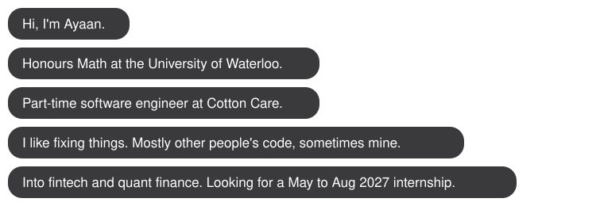

[Website](https://www.ayaanmohsin.xyz) · [LinkedIn](https://linkedin.com/in/ayaan-mohsin-119b57236) · [Email](mailto:ayaanmohsin15945@gmail.com) · [Resume](https://www.ayaanmohsin.xyz/resume.pdf)

## Things I fixed

I read other people's repos, find what's broken, and send a PR.

| Repo | What was broken | PR |
|---|---|---|
| [Ose-Jossy/Nova-Bank](https://github.com/Ose-Jossy/Nova-Bank) | The accounts service had been overwritten by a copy of the auth service. OTP check could be bypassed. Transfers weren't atomic. | [#1](https://github.com/Ose-Jossy/Nova-Bank/pull/1): restore accounts-service, close the OTP bypass, make transfers atomic and idempotent |
| [jyotisihagjaat/AI-Product-Recognition](https://github.com/jyotisihagjaat/AI-Product-Recognition) | Install broke, and inference didn't match how the model was trained. | [#1](https://github.com/jyotisihagjaat/AI-Product-Recognition/pull/1): fix install, align inference with training, add an Unknown class |

I fix my own stuff too:

- [cardopt](https://github.com/ayaanmohsin066/cardopt): fixed two solver bugs and added a claims check so the README can't say more than the code does ([#1](https://github.com/ayaanmohsin066/cardopt/pull/1)).
- [lunar-lander-ai](https://github.com/ayaanmohsin066/lunar-lander-ai): fixed the outcome and landing metrics, then re-ran the experiments ([#1](https://github.com/ayaanmohsin066/lunar-lander-ai/pull/1)).

## Things I built

| Project | What it does | Stack |
|---|---|---|
| [CardWise](https://github.com/ayaanmohsin066/cardopt) | Picks which credit card to use for each spending category. Solves it as a linear program in the browser with HiGHS (WebAssembly). Your data never leaves the browser. | TypeScript, Next.js, WebAssembly, Vitest |
| [Lunar Lander AI](https://github.com/ayaanmohsin066/lunar-lander-ai) | PPO agent that lands a rocket in wind and turbulence. Compares PPO, A2C and DQN, plus a reward-shaping ablation with significance tests. | Python, PyTorch, Stable-Baselines3, Gymnasium |
| [LibraryCheck](https://library-tracker-phi.vercel.app) | Live library occupancy for Waterloo and other universities. A server-side proxy polls the Waitz API every 5 minutes. | Next.js, Vercel |

## Tools

Python · TypeScript · JavaScript · SQL · Next.js · React · Prisma · PostgreSQL · PyTorch · pandas · NumPy · SciPy · Zod · Vitest · Git · Vercel

## GitHub stats

  
  

  

  

